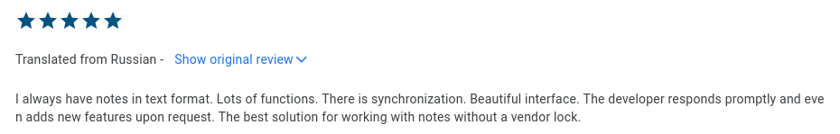
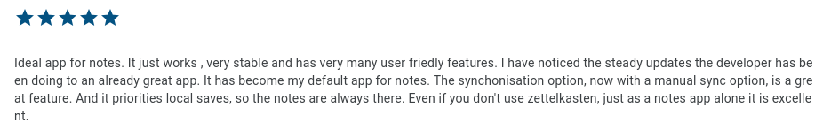
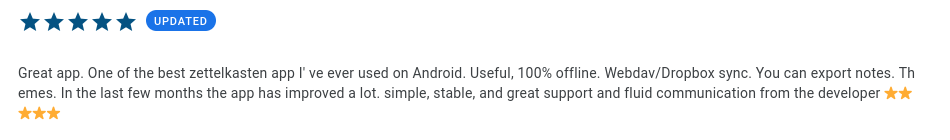

**Zettel Notes** is a Markdown note-taking app for Android. Your notes stay as plain-text files in folders you control, so no app ever locks you in.

[Download](download.md){ .md-button .md-button--primary } [Privacy Policy](https://thedoc.eu.org/zettel-notes/privacy){ .md-button }

## Why Zettel Notes?

- **Plain-text files.** Every note is a separate Markdown, text or Org file that any other app can open.
- **Use your existing notes.** Add any folder as a [repository](repository/index.md) and your notes appear immediately.
- **Free, with no ads.** No hidden permissions and no collection of user data.
- **Offline first.** Everything works without an internet connection; [sync](repository/synchronization/index.md) is optional.

## Getting started

1. [Install Zettel Notes](download.md). The app opens with an introductory note.
2. Open the menu, select **Repositories**, and add the folder that holds your notes (or start fresh in the app's own folder).
3. Read about [notes](note/index.md), the [editor](note/editor/index.md) and [Markdown formatting](note/editor/markdown.md).

## Features

**Writing and linking**

- [Markdown formatting](note/editor/markdown.md) with [LaTeX](note/editor/markdown.md#latex), tables and task lists
- [Zettelkasten support](note/editor/zettelkasten.md): wiki links, backlinks, tags and authors
- [Note types](note/note-types.md): task, drawing, audio, bookmark and log notes
- [Templates](templates.md) and [YAML frontmatter](note/yaml-frontmatter.md)
- [Citation manager](bibtex.md) for BibTeX and CSL JSON

**Organising and finding**

- Multiple [repositories](repository/index.md) with subfolders; MD, TXT and Org files
- Full-text search and [saved searches](saved-searches.md)
- Sort by name, edit time, creation time, word count or how often a note is opened
- Bookmark and pin notes, [calendar view](calendar.md), [gallery](gallery.md) and [recycle bin](recycle-bin.md)

**Sync and security**

- [Git, Dropbox, WebDAV and SFTP sync](repository/synchronization/index.md) with a built-in [keys manager](repository/synchronization/keys-manager.md)
- [Note encryption](repository/encryption.md) with a password or PGP key
- [App lock](app-lock.md) with biometrics
- [Automatic backups](auto-backup.md)

**Customisation and integration**

- [App themes](themes/app-theme.md), [Markdown styles](themes/markdown-theme.md) and [fonts](themes/font-downloader.md)
- [Keyboard shortcuts](keyboard-shortcuts.md)
- [Share notes](note/share-note/index.md) as PDF, HTML, launcher shortcuts, widgets or pinned notifications
- [Clip web pages](web-clipper.md) or share text from any app into a note
- [Tasker integration](tasker.md) and [plugins](plugins/index.md)

!!! tip "Request a feature"

    Suggest new features in [GitHub Discussions](https://github.com/damionx7/Zettel-Notes-Documentation/discussions).

## Community and support

- [Email](mailto:info@thedoc.eu.org)
- [Google Group](https://groups.google.com/g/znotes)
- [Telegram channel](https://t.me/zettelnotes) and [support group](https://t.me/joinchat/DZ2eFcOk3Mo4MDk1)
- [Reddit](https://www.reddit.com/r/Zettelkasten/comments/npr00a/introducing_my_new_android_app_for_zettelkasten/) and [Zettelkasten.de forum](https://forum.zettelkasten.de/discussion/1844/introducing-my-new-android-app-for-zettelkasten-zettel-notes/)
- [Rate on the Play Store](https://thedoc.eu.org/redirect/zettel-notes)

Zettel Notes is translated into many languages by its community. [See the list or help translate](translations.md).

## Support development

Zettel Notes is built by a solo developer. If it has helped you, consider supporting its development with a one-time donation or a membership.

[Become a member](https://www.buymeacoffee.com/dr.rohit/membership){ .md-button .md-button--primary } [Donate :simple-buymeacoffee:](https://www.buymeacoffee.com/dr.rohit){ .md-button }

## What users say

{: style="width:100%"}

{: style="width:100%"}

{: style="width:100%"}

## Disclaimer

The software is provided "as is", without warranty of any kind, express or implied, including but not limited to the warranties of merchantability, fitness for a particular purpose and noninfringement. By using this software, you agree that the developer will not be liable for any damages, including but not limited to loss of data, revenue or profits, arising out of or connected with the use of the application.
