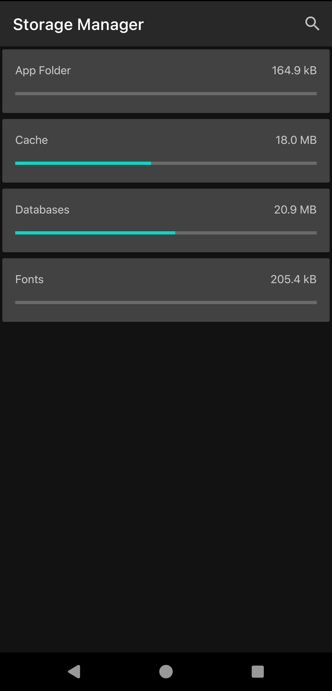

The Storage Manager shows and manages files in the app's private storage.

To open it, go to `Android Settings > Apps > Zettel Notes > Storage and Cache > Manage Space`

It lists internal repositories, App Folder, Cache, Fonts and Database files, sorted by size.

