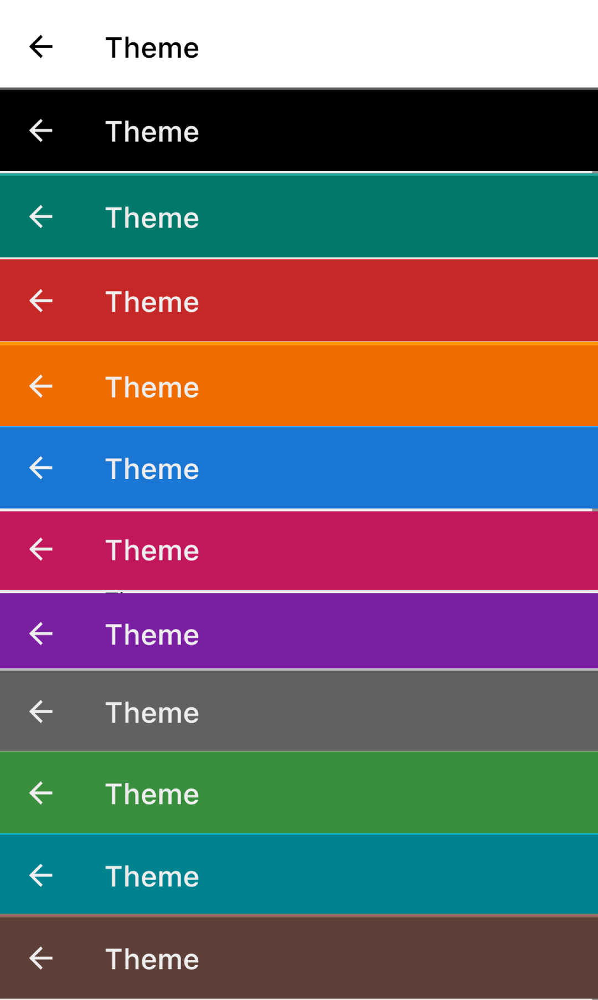

Zettel Notes has light and dark base themes, and can follow the Android system setting.

Each base theme can be customised with `Accent Color`, `Background Color`, `Viewer Font`, `Editor Font` and `Markdown Style`.

To configure theme, go to `Settings > Theme`.

## App icon

Choose from 15 alternate launcher icons in `Misc > Switch App Icon` [v2.8.6](../changelog.md#286){ .zn-version }.

## Font

You can import font `ttf` file from storage or use any font from Google Fonts. [Read more](./font-downloader.md).

## Markdown Style

You can configure separate markdown style for light and dark theme. [Read more](./markdown-theme.md)

## Accent Colors

- Blue
- Brown
- Cyan
- Green
- Grey
- Orange
- Pink
- Purple
- Red
- Teal

## Toolbar Colors

Available toolbar colours:

## Background Colors

Available background colours:

<figure>

 <figcaption>White Background</figcaption>
</figure>

<figure>

 <figcaption>Black Background</figcaption>
</figure>

<figure>

 <figcaption>Blue (Light) Background</figcaption>
</figure>

<figure>

 <figcaption>Blue Background</figcaption>
</figure>

<figure>
  
  <figcaption>Green Background</figcaption>
</figure>

<figure>
  
  <figcaption>Teal Background</figcaption>
</figure>

<figure>
  
  <figcaption>Red Background</figcaption>
</figure>

<figure>
  
  <figcaption>Newspaper Background</figcaption>
</figure>

<figure>
  
  <figcaption>Terminal Background</figcaption>
</figure>

